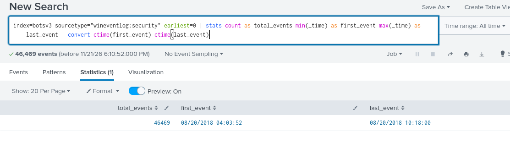
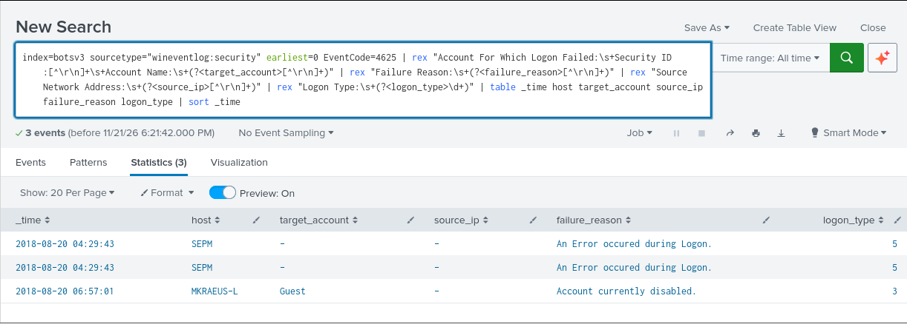
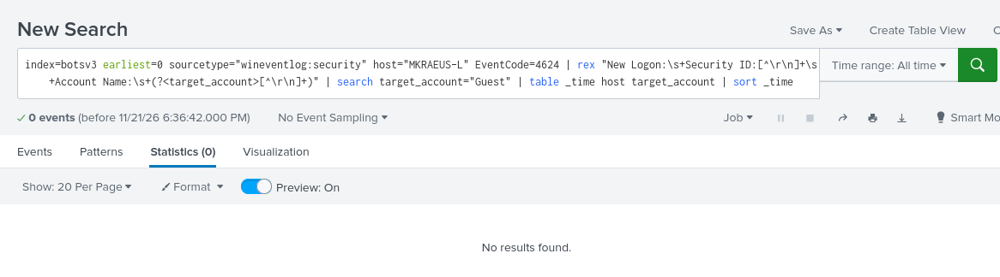
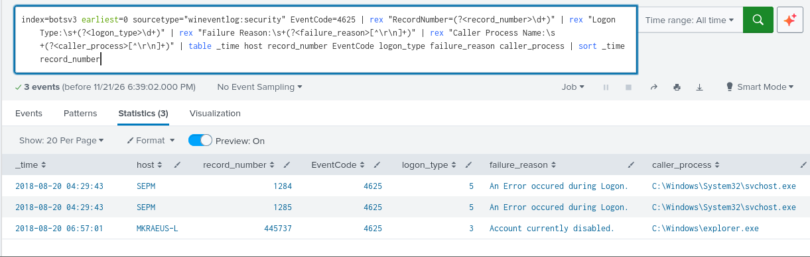

# Lab 2 - Splunk Log Triage & Escalation
## Security Operations (SOC) | Cybersecurity Home Lab

### 1. Project Overview

This project simulates a Tier 1 Security Operations Center (SOC) investigation using Splunk Enterprise and the Boss of the SOC Version 3 (BOTSv3) training dataset.

The investigation focuses on Windows authentication failures, event correlation, suspicious activity assessment, incident timeline reconstruction, and evidence-based escalation decision-making.

### 2. Objectives

- Explore and establish a baseline of security logs.
- Identify failed Windows authentication events.
- Extract relevant security information using SPL and regular expressions.
- Investigate potentially suspicious authentication activity.
- Evaluate alternative explanations for observed events.
- Construct a chronological incident timeline.
- Assign severity and justify an escalation decision.

### 3. Lab Environment

| Component | Details |
|---|---|
| Virtualization | VMware Workstation Pro 17 |
| Operating System | Kali Linux |
| Security Analytics Platform | Splunk Enterprise 10.6.2.5 |
| Dataset | Boss of the SOC Version 3 (BOTSv3) |
| Index | botsv3 |
| Log Source | WinEventLog:Security |
| Investigation Language | Search Processing Language (SPL) |
| Investigation Date in Dataset | August 20, 2018 |

### 4. Investigation Methodology

1. Installed and configured Splunk Enterprise.
2. Loaded and verified the BOTSv3 training dataset.
3. Enumerated available log sourcetypes.
4. Established a Windows security event baseline.
5. Identified failed authentication events (Event ID 4625).
6. Extracted authentication details using regular expressions.
7. Investigated service-related and disabled-account authentication failures.
8. Performed a successful authentication correlation search (Event ID 4624).
9. Constructed an incident timeline and documented the escalation decision.

### 5. Key Findings

| Metric | Result |
|---|---|
| Windows security events reviewed | 46,469 |
| Failed authentication records identified | 3 |
| Affected hosts | 2 |
| Service logon failures | 2 |
| Disabled Guest account logon failures | 1 |
| Matching successful Guest logins | 0 |
| Confirmed security compromise | None identified |
| Assigned severity | Low |
| Assessment confidence | Moderate |
| Escalation decision | No immediate security escalation |

### 6. Investigation Evidence

#### Dataset and Security Log Baseline

Established the volume and observation period of available Windows security events.

#### Authentication Investigation

Identified failed authentication records across SEPM and MKRAEUS-L, including service logon failures and an attempted network logon to a disabled Guest account.

#### Successful Authentication Correlation

A correlation query returned no matching successful Guest authentication events on MKRAEUS-L.

#### Incident Timeline

Reconstructed the chronological sequence of authentication failure records using SPL field extraction, aggregation during earlier analysis, and event sorting.

### 7. SOC Triage Decision

The investigation identified two distinct service authentication failure records on SEPM and one failed network logon to a disabled Guest account on MKRAEUS-L.

The available evidence suggests possible service privilege or configuration issues and potentially benign network authentication activity.

The observed events did not establish a brute-force attack or successful unauthorized access.

The activity was classified as Low severity with moderate confidence. Immediate Tier 2 security escalation was not recommended.

An IT operations review would be appropriate if the service-related failures recur or affect service availability.

### 8. Technical Documentation

- [SPL Queries and Investigation Results](spl-queries.md)
- [SOC Triage and Escalation Report](escalation-report.md)
- [Complete Investigation Screenshots](screenshots/)

### 9. Skills Demonstrated

- Security log analysis
- Splunk Enterprise configuration
- Search Processing Language (SPL)
- Windows security event analysis
- Regular expression field extraction
- Authentication event correlation
- Incident timeline reconstruction
- Alternative hypothesis evaluation
- Security severity assessment
- SOC alert triage and escalation decision-making
- Technical security documentation

### 10. Lessons Learned

This investigation demonstrated that failed authentication events do not automatically indicate malicious activity.

Understanding logon types, caller processes, account status, event record numbers, and related authentication events is essential for distinguishing potential threats from routine operational issues.

The lab also reinforced the importance of documenting investigation limitations and making escalation decisions based on evidence rather than assumptions.

### 11. Limitations

The investigation was limited to historical training data and selected Windows authentication events. Source IP addresses were unavailable in the examined failure records, and process legitimacy was not independently verified.

The absence of matching successful Guest authentication events does not conclusively rule out unauthorized access.

### Dataset Reference

[Splunk — Boss of the SOC Version 3 (BOTSv3)](https://github.com/splunk/botsv3)

### Disclaimer

This project was conducted in a personal virtual lab environment using publicly available cybersecurity training data for educational and professional development purposes.
