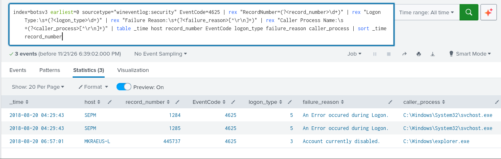
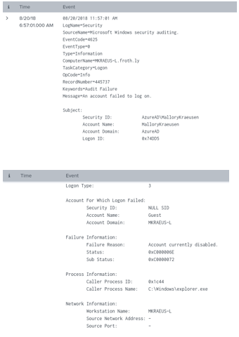
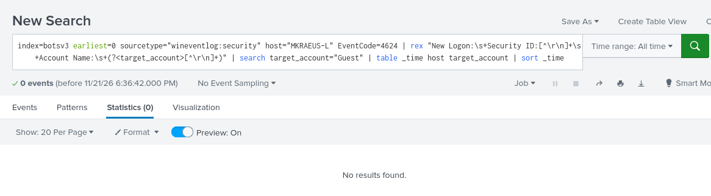

# SOC Triage and Escalation Report

## 1. Incident Overview

| Field | Details |
|---|---|
| Incident ID | LAB02-001 |
| Incident Title | Windows Authentication Failure Investigation |
| Analyst Role | Tier 1 SOC Analyst (Simulated) |
| Data Source | Splunk BOTSv3 |
| Incident Date | August 20, 2018 |
| Event ID | 4625 |
| Classification | Authentication Failure |
| Severity | Low |
| Confidence | Moderate |
| Disposition | No immediate security escalation recommended |

## 2. Executive Summary

An investigation of 46,469 Windows security events using Splunk Enterprise identified three failed authentication records across two hosts: SEPM and MKRAEUS-L.

The investigation revealed two potentially related service authentication failures and one attempted network logon to a disabled Guest account.

No sufficient evidence of brute-force activity or successful unauthorized access was identified within the scope of the investigation.

## 3. Incident Timeline

All timestamps reflect Splunk's displayed event times.

| Timestamp | Host | Record Number | Activity |
|---|---|---|---|
| 2018-08-20 04:29:43 | SEPM | 1284 | Service logon failure |
| 2018-08-20 04:29:43 | SEPM | 1285 | Service logon failure |
| 2018-08-20 06:57:01 | MKRAEUS-L | 445737 | Disabled Guest account logon failure |

## 4. Technical Findings

### Finding 1 - SEPM Service Authentication Failures

- Subject account: SEPM$
- Security ID: S-1-5-18 (Local System)
- Logon Type: 5 (Service)
- Caller process: C:\Windows\System32\svchost.exe
- Process ID: 0x4fc
- Status and substatus: 0xC0000073
- Record numbers: 1284 and 1285
- Source IP address: Not recorded

The consecutive record numbers confirm that these are distinct Windows event records rather than duplicates of the same record.

The identical timestamps, caller process, logon type, and status codes suggest a potentially related service privilege or configuration issue.

The exact root cause remains unverified.

### Finding 2 - Disabled Guest Account Logon Failure

- Host: MKRAEUS-L
- Requesting account: MalloryKraeusen
- Account domain: AzureAD
- Target account: Guest
- Logon Type: 3 (Network)
- Caller process: C:\Windows\explorer.exe
- Status: 0xC000006E
- Substatus: 0xC0000072
- Failure reason: Account currently disabled
- Source IP address: Not recorded

The authentication request was rejected because the Guest account was disabled.

A legitimate attempt to access a network resource is a plausible explanation. However, the requesting user's intent cannot be established from the available logs.

## 5. Correlation Analysis

A search for successful Guest authentication events (Event ID 4624) on MKRAEUS-L returned no matching results.

This finding supports the low-severity assessment but does not conclusively rule out unauthorized access.

## 6. Severity Justification

The observed activity was classified as Low severity based on:

- Low volume of failed authentication events.
- Absence of an identified brute-force pattern.
- Service-related characteristics of the SEPM failures.
- Rejection of the disabled Guest account logon.
- No matching successful Guest authentication identified.

## 7. Escalation Decision

Immediate escalation to Tier 2 security analysts is not recommended based on the available evidence.

An IT operations review is recommended if the SEPM authentication failures recur or affect service availability.

Security escalation should be reconsidered if additional evidence indicates:

- Repeated or increasing authentication failures.
- Suspicious source IP addresses.
- Unauthorized successful authentication.
- Malicious process activity.

## 8. Recommendations

- Maintain the disabled status of unnecessary Guest accounts.
- Review service permissions if SEPM authentication failures recur.
- Continue monitoring Windows authentication events.
- Investigate unusual increases in failed authentication attempts.
- Correlate authentication activity with endpoint and network logs when warranted.

## 9. Investigation Limitations

- Historical training data was used.
- Source IP addresses were unavailable in the examined events.
- Process legitimacy was not independently verified.
- The successful login check relied on a specific SPL field-extraction query.
- The relationship between the SEPM failures and MKRAEUS-L activity was not established.
- No confirmed compromise was identified within the investigation scope.

## 10. Conclusion

The available evidence supports a preliminary assessment of likely benign authentication failures requiring no immediate security escalation.

This investigation demonstrates evidence-based SOC triage, log analysis, event correlation, alternative hypothesis evaluation, severity classification, and escalation decision-making.
