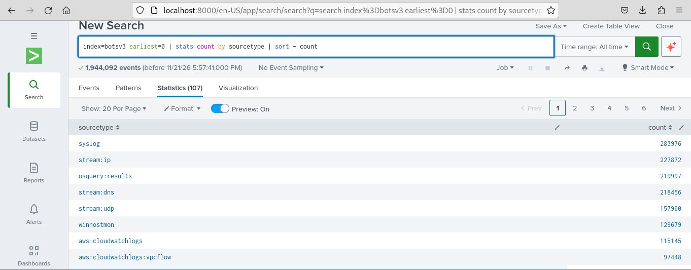
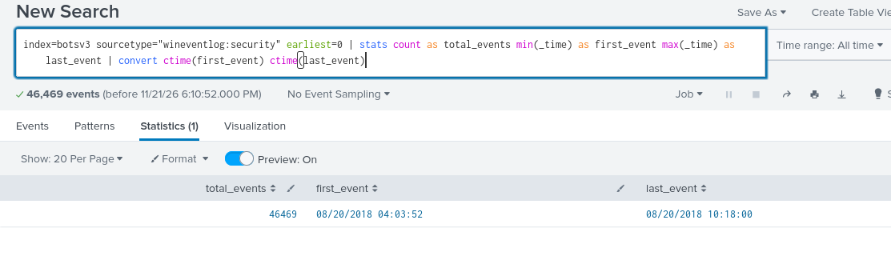
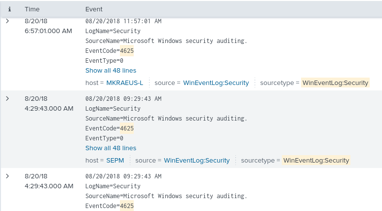
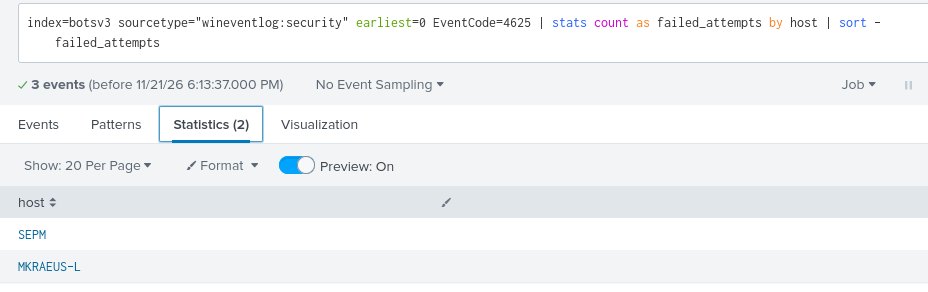
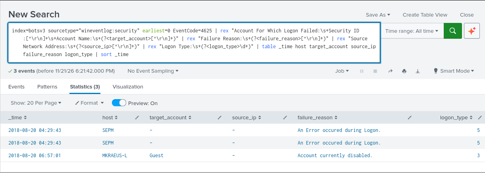
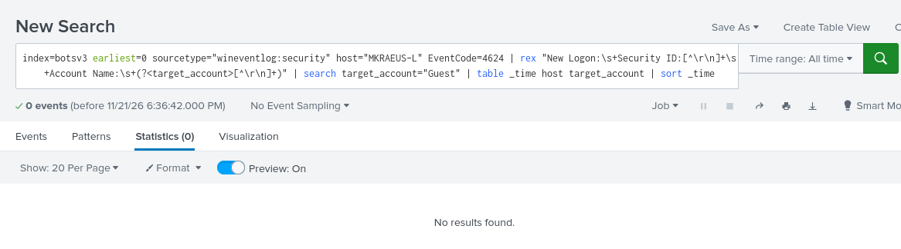
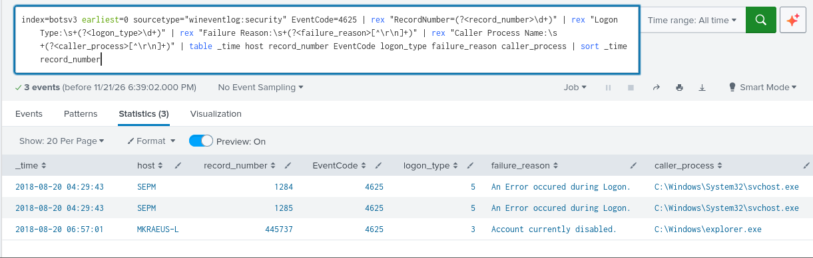

# Splunk SPL Query Documentation

## Environment

- Platform: Splunk Enterprise 10.6.2.5
- Operating System: Kali Linux
- Dataset: Boss of the SOC Version 3 (BOTSv3)
- Index: botsv3
- Time Range: All time

## Query 1 - Dataset Verification

Purpose: Verify successful ingestion and availability of the BOTSv3 dataset.

```spl
index=botsv3 earliest=0
```

Result: Historical training events successfully retrieved.

## Query 2 - Sourcetype Enumeration

Purpose: Identify available log categories and their event volumes.

```spl
index=botsv3 earliest=0
| stats count by sourcetype
| sort - count
```

Result: Identified multiple log categories, including 46,469 Windows security events.



## Query 3 — Windows Security Log Baseline

Purpose: Establish the event volume and observation period.

```spl
index=botsv3 sourcetype="wineventlog:security" earliest=0
| stats count as total_events min(_time) as first_event max(_time) as last_event
| convert ctime(first_event) ctime(last_event)
```

Result:

- Total events: 46,469
- First event: 08/20/2018 04:03:52
- Last event: 08/20/2018 10:18:00



## Query 4 - Initial Failed Authentication Search

Purpose: Identify potential Windows failed authentication events.

```spl
index=botsv3 sourcetype="wineventlog:security" earliest=0 "4625"
```

Raw event inspection confirmed EventCode 4625.



## Query 5 - Failed Authentication Counts by Host

Purpose: Identify computers recording failed authentication attempts.

```spl
index=botsv3 sourcetype="wineventlog:security" earliest=0 EventCode=4625
| stats count as failed_attempts by host
| sort - failed_attempts
```

Result:

| Host | Failed Authentication Records |
|---|---:|
| SEPM | 2 |
| MKRAEUS-L | 1 |
| Total | 3 |



## Query 6 - Raw Authentication Event Inspection

Purpose: Examine failed authentication event details.

```spl
index=botsv3 sourcetype="wineventlog:security" earliest=0 EventCode=4625
```

Expanded raw events were inspected to identify target accounts, failure reasons, logon types, caller processes, and network information.

## Query 7 - Authentication Field Extraction

Purpose: Extract relevant authentication fields using regular expressions.

```spl
index=botsv3 sourcetype="wineventlog:security" earliest=0 EventCode=4625
| rex "Account For Which Logon Failed:\s+Security ID:[^\r\n]+\s+Account Name:\s+(?<target_account>[^\r\n]+)"
| rex "Failure Reason:\s+(?<failure_reason>[^\r\n]+)"
| rex "Source Network Address:\s+(?<source_ip>[^\r\n]+)"
| rex "Logon Type:\s+(?<logon_type>\d+)"
| table _time host target_account source_ip failure_reason logon_type
| sort _time
```

Result: Identified two service logon failures and one disabled Guest account logon failure.



## Query 8 - SEPM Service Authentication Investigation

Purpose: Investigate service-related authentication failures and compare event records.

```spl
index=botsv3 earliest=0 sourcetype="wineventlog:security" host="SEPM" EventCode=4625
```

Result:

- Record numbers: 1284 and 1285
- Logon Type: 5
- Caller process: svchost.exe
- Status: 0xC0000073

The distinct record numbers confirmed two separate event records.

## Query 9 - Successful Guest Authentication Correlation

Purpose: Determine whether successful Guest authentication was recorded on MKRAEUS-L.

```spl
index=botsv3 earliest=0 sourcetype="wineventlog:security" host="MKRAEUS-L" EventCode=4624
| rex "New Logon:\s+Security ID:[^\r\n]+\s+Account Name:\s+(?<target_account>[^\r\n]+)"
| search target_account="Guest"
| table _time host target_account
| sort _time
```

Result: No matching results.

Limitation: The absence of matching records does not conclusively rule out unauthorized access.



## Query 10 - Incident Timeline

Purpose: Construct a chronological timeline of failed authentication records.

```spl
index=botsv3 earliest=0 sourcetype="wineventlog:security" EventCode=4625
| rex "RecordNumber=(?<record_number>\d+)"
| rex "Logon Type:\s+(?<logon_type>\d+)"
| rex "Failure Reason:\s+(?<failure_reason>[^\r\n]+)"
| rex "Caller Process Name:\s+(?<caller_process>[^\r\n]+)"
| table _time host record_number EventCode logon_type failure_reason caller_process
| sort _time record_number
```

Result: Three authentication failure records arranged chronologically.



## SPL Skills Demonstrated

| Command | Purpose |
|---|---|
| search | Filter matching events |
| stats | Aggregate and count events |
| sort | Order search results |
| rex | Extract fields using regular expressions |
| table | Display selected investigation fields |
| convert | Convert timestamp values |
| min | Identify earliest event |
| max | Identify latest event |

## Dataset Reference

Official Splunk BOTSv3 training dataset:

https://github.com/splunk/botsv3
